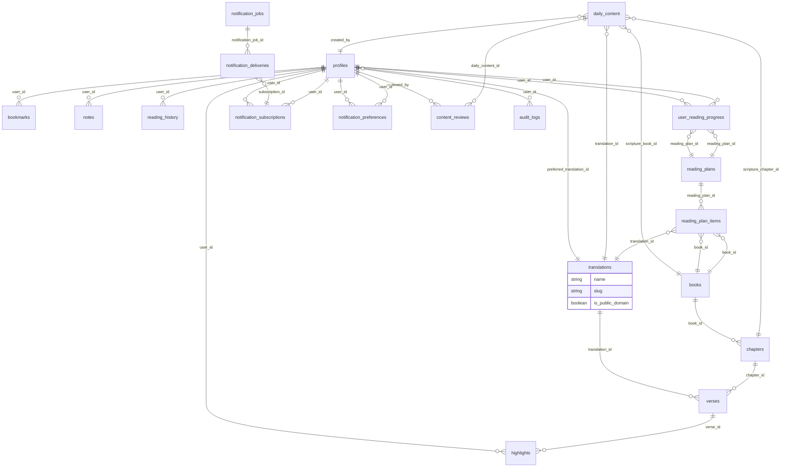
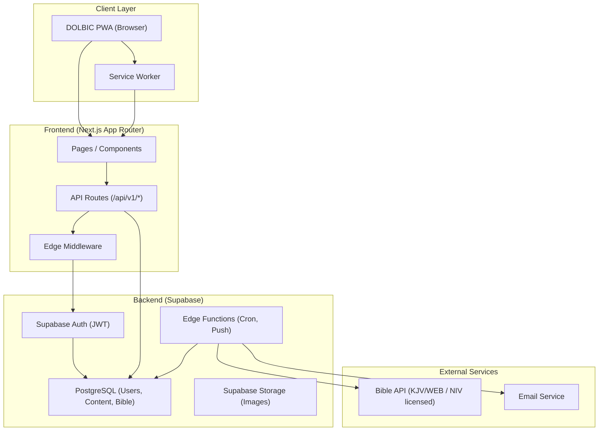
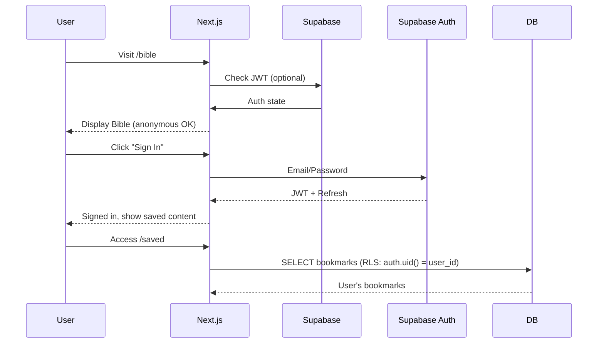
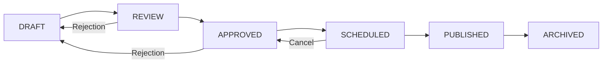

# DOLBIC Bible Web App — Architecture Planning Document

> **Status:** Planning & Research Only — No Code Has Been Written
> **Author:** Lead Product Architect & Senior Full-Stack Engineer
> **Client:** Dominion Life Bible Church (DOLBIC), Abuja, Nigeria
> **Date:** 2026-09-16
> **Scope:** Web-first PWA with future React Native/Expo mobile extension

---

## 1. Executive Summary

The **DOLBIC Bible Web App** is a web-first Progressive Web App (PWA) designed to serve as the primary digital channel for Dominion Life Bible Church. The app puts the Bible at the center of the user experience while delivering daily devotional content (Scripture, quote, prayer, reflection). It must be responsive across mobile, tablet, and desktop, SEO-friendly, performant on low-bandwidth Nigerian connections, and designed for future extension to native mobile apps.

**Key Architectural Decision:** The recommended architecture is **Next.js (App Router) + Supabase (PostgreSQL + Auth + Storage + Edge Functions) + Vercel**. This stack provides:
- A unified codebase reusable for future React Native/Expo mobile apps
- Managed infrastructure (Supabase handles DB, Auth, Storage; Vercel handles CDN and scaling)
- Server-side rendering for SEO and performance
- Built-in Row-Level Security for multi-tenant data isolation
- Edge Functions for daily push notification scheduling

**Critical Blocking Dependency — NIV Licensing:**
NIV (New International Version) is copyrighted by Zondervan (HarperCollins Christian Publishing). Public display, reproduction, or distribution of NIV text requires a commercial license. The architecture must either:
1. Use public-domain translations (KJV, WEB) as the MVP default, with NIV integrated later via a licensed API (e.g., API.Bible commercial tier), OR
2. Secure a direct NIV license from Zondervan before launch.

Without resolving this licensing question, the MVP **cannot legally serve NIV content**. The architecture must support both public-domain and licensed translations without code changes — this is a core design principle.

---

## 2. Product Requirements

### 2.1 Core Features
- Bible reading (books → chapters → verses)
- Bible search (within a translation)
- Book/chapter/verse navigation
- Daily Scripture, quote, prayer, reflection
- Bookmarks and highlights
- Personal notes/reflections
- Reading history
- Reading plans (guided reading schedules)
- Daily push notifications (Web Push)
- Sharing of Scripture and daily content
- User accounts (anonymous + registered)
- Secure DOLBIC admin dashboard (content creation, review, approval, scheduling)
- Responsive design (mobile-first)
- Offline-friendly PWA behavior
- SEO-friendly public Bible and daily-content pages

### 2.2 Non-Functional Requirements
- **Performance:** Optimized for low-bandwidth Nigerian connections (3G/4G), inexpensive Android devices (<$150 RAM)
- **Security:** HTTPS everywhere, Row-Level Security (RLS), JWT authentication, input sanitization
- **Reliability:** Web Push with retry/backoff, offline caching, graceful degradation
- **Maintainability:** Single codebase for web and future mobile apps; decoupled domain models
- **Extensibility:** Abstracted notification provider (Web Push → FCM → APNs)
- **Legal Compliance:** All Bible text handled according to licensing terms; no copyrighted text distributed without permission

### 2.3 Bible Translation Strategy
- **MVP Translations:** KJV and WEB (both public domain)
- **Future Translation:** NIV via licensed API (when funding and legal clearance are secured)
- **Translation Abstraction:** All Bible reader components must be translation-agnostic — never hard-code KJV or WEB logic
- **No Code Coupling:** Bible reading UI, search, bookmarks, and daily content must not reference translation names directly

---

## 3. Verified Assumptions

| Assumption | Confidence | Evidence | Source | Date Checked | Architectural Impact |
|------------|------------|----------|--------|-------------|----------------------|
| KJV is public domain in Nigeria (outside UK) | High | "The KJV is public domain in the United States" — Bible Gateway; Wikipedia confirms public domain globally except UK | [Wikipedia](https://en.wikipedia.org/wiki/King_James_Version), [BibleGateway](https://www.biblegateway.com/versions/King-James-Version-KJV-Bible/) | 2026-09-16 | KJV text can be legally stored in Supabase and served via our API in Nigeria |
| WEB is explicitly public domain | High | "The World English Bible is in the Public Domain" — eBible.org official copyright page | [eBible.org](https://ebible.org/engwebp/copyright.htm) | 2026-09-16 | WEB text can be stored, served, and used in mobile apps without restriction |
| NIV is copyrighted by Zondervan | High | Bible Gateway lists NIV as a commercial version; API.Bible charges for copyrighted translations | [API.Bible](https://api.bible/faq), [BibleGateway](https://www.biblegateway.com/versions/New-International-Version-NIV-Bible/) | 2026-09-16 | NIV cannot be stored in our database without a license; requires external API integration |
| API.Bible offers public-domain texts (KJV, WEB) on free tier | High | API.Bible Starter plan ($0) includes 3 public-domain translations, 5,000 API calls/month | [API.Bible](https://api.bible/) | 2026-09-16 | MVP can use API.Bible free tier for Bible content delivery without cost |
| Web Push with VAPID is the standard | High | RFC 8292; widely supported by Chrome, Firefox, Edge | [MDN](https://developer.mozilla.org/en-US/docs/Web/API/Push_API) | 2026-09-16 | Web Push can be implemented without proprietary dependencies |
| Supabase provides RLS, Auth, Storage, Edge Functions | High | Supabase official documentation confirms all features | [Supabase](https://supabase.com/docs) | 2026-09-16 | Supabase is a suitable backend platform for the MVP |
| Next.js App Router supports SSR, SSG, ISR | High | Well-documented Next.js feature | [Next.js](https://nextjs.org/docs/app) | 2026-09-16 | Next.js can serve SEO-friendly public pages |
| Vercel provides cron jobs for daily scheduling | High | Vercel Cron Jobs feature documented | [Vercel](https://vercel.com/docs/cron-jobs) | 2026-09-16 | Daily push dispatch can be automated via Vercel Cron |

---

## 4. Unverified Assumptions

| Assumption | Status | Action Required |
|------------|--------|-----------------|
| API.Bible free tier (Starter) supports KJV and WEB simultaneously | Needs verification | Confirm API.Bible free tier allows requesting both KJV and WEB concurrently; verify rate limits |
| Supabase RLS can enforce all required data isolation patterns | Medium | Will be validated during database schema design phase |
| Next.js App Router ISR (Incremental Static Regeneration) supports per-page cache invalidation | High | Well-documented; will validate with prototype |
| Web Push notification delivery rate is acceptable for daily mass notifications | Medium | Requires load testing with thousands of subscriptions |
| Nigerian mobile users will accept PWA install prompt | Medium | Requires user testing; can be deferred |
| Supabase Edge Functions can handle VAPID key operations efficiently | High | Edge Functions have 1MB payload limit; VAPID operations are lightweight |
| Daily content workflow (DRAFT→REVIEW→APPROVED→SCHEDULED→PUBLISHED→ARCHIVED) can be enforced via Supabase RLS alone | Medium | Requires validation; likely needs application-layer enforcement in addition to RLS |
| Browser Web Push works reliably on Nigerian mobile networks | Medium | Requires real-world testing; may need fallback mechanisms |

---

## 5. Research Findings

### 5.1 NIV Licensing (Verified)
- **Source:** [BibleGateway](https://www.biblegateway.com/versions/New-International-Version-NIV-Bible/), [API.Bible FAQ](https://api.bible/faq), [Wikipedia](https://en.wikipedia.org/wiki/New_International_Version)
- **Copyright Holder:** Zondervan (HarperCollins Christian Publishing)
- **Status:** Copyrighted text. Public display, reproduction, or distribution requires a commercial license.
- **API.Bible Access:** Available via commercial tier ($29+/month Pro plan); Starter plan ($0) does not include NIV
- **Restriction:** Cannot be stored in our database or served through our own API without a license
- **Blocking Impact:** NIV cannot be the default translation for the MVP

### 5.2 KJV Licensing (Verified)
- **Source:** [Wikipedia](https://en.wikipedia.org/wiki/King_James_Version), [BibleGateway](https://www.biblegateway.com/versions/King-James-Version-KJV-Bible/), [Selling Jesus](https://sellingjesus.org/articles/kjv)
- **Status:** Public domain in most countries including Nigeria and the United States. Perpetual Crown copyright exists only in the United Kingdom (managed by Cambridge University Press, Oxford University Press, and Collins).
- **Quote from Bible Gateway:** "The King James Version present on the Bible Gateway matches the 1987 printing. The KJV is public domain in the United States."
- **Restriction:** In the UK, Crown copyright persists. Nigeria (not UK) has no restriction.
- **Verdict:** KJV can be stored in Supabase, served via our API, and used in future mobile apps without licensing concerns for the Nigerian market.

### 5.3 WEB Licensing (Verified)
- **Source:** [eBible.org Copyright Page](https://ebible.org/engwebp/copyright.htm), [Wikipedia](https://en.wikipedia.org/wiki/World_English_Bible)
- **Status:** Explicitly public domain — "The World English Bible is in the Public Domain. That means that it is not copyrighted."
- **Quote from eBible.org:** "You may copy, publish, proclaim, distribute, redistribute, sell, give away, quote, memorize, read publicly, broadcast, transmit, share, back up, post on the Internet, print, reproduce, preach, teach from, and use the World English Bible as much as you want, and others may also do so."
- **Trademark Note:** "World English Bible" is a trademark of eBible.org, but this does not restrict use of the text itself.
- **Restriction:** If text is modified, the result cannot be called "World English Bible."
- **Verdict:** WEB can be stored, served, and used freely. Attribution to eBible.org is appreciated but not legally required.

### 5.4 Bible API Comparison (Verified)
| Provider | Public Domain Texts | Licensed NIV | Pricing Model | Notes |
|----------|---------------------|--------------|---------------|-------|
| **API.Bible** | KJV, WEB (free tier: 5K calls/month) | Yes (Pro: $29+/month, 150K calls) | Tiered subscription | Supports caching (refresh every 30 days); FUMS system for tracking |
| **OpenBible.info** | KJV, WEB, NASB | Limited | Free with attribution | Good for public domain texts |
| **Bible Gateway API** | Requires access token | Yes (requires authorization) | Access token required | Uses `api.biblegateway.com/2/`; requires credentials |
| **YouVersion (Bible.com)** | KJV, WEB | Yes (commercial) | Paid subscription | Popular but requires account/login |

### 5.5 Web Push & PWA Architecture (Verified)
- **Standard:** Web Push API (RFC 9287) + VAPID keys (RFC 9618)
- **Source:** [MDN](https://developer.mozilla.org/en-US/docs/Web/API/Push_API), [Bocoup Guide](https://www.bocoup.com/blog/full-stack-web-push-api-guide)
- **Service Worker:** Manages push subscription lifecycle, offline caching, and background sync
- **VAPID:** Voluntary Application Server Identification; provides authentication without requiring user credentials
- **Provider Abstraction:** Architecture must define a notification provider interface so the system can swap between Web Push, FCM (Android), and APNs (iOS) without changing business logic

### 5.6 Supabase (Verified)
- **Stack:** PostgreSQL (relational), Auth (email/password, magic link, social OAuth), Storage (files), Edge Functions (serverless), Realtime (WebSocket)
- **RLS:** Row-Level Security policies enforce data isolation at the database level
- **Edge Functions:** Lightweight serverless functions ideal for daily push scheduling, notification queuing
- **Cost:** Free tier sufficient for MVP; paid tiers scale with user count
- **Source:** [Supabase Documentation](https://supabase.com/docs)

### 5.7 Next.js + Vercel (Verified)
- **App Router:** Server-side rendering (SSR), static generation (SSG), incremental static regeneration (ISR)
- **Middleware:** Client-side routing, authentication guards, redirects
- **Vercel:** Global CDN, edge functions, serverless API routes, cron jobs (for daily push scheduling)
- **PWA:** Service worker support via `next-pwa` or `workbox-webpack-plugin`
- **Source:** [Next.js](https://nextjs.org/docs), [Vercel](https://vercel.com/docs)

---

## 6. NIV Licensing Findings — Detailed Analysis

### 6.1 Current Legal Status
NIV is copyrighted by Zondervan (HarperCollins). The text is protected by international copyright conventions (Berne Convention, Universal Copyright Convention). Nigeria is a signatory to both conventions, meaning Nigerian copyright law recognizes NIV's copyright.

### 6.2 Licensing Pathways
1. **Direct License from Zondervan** — Contact HarperCollins Christian Publishing for commercial use licensing. Costs unknown; likely significant for church/web usage.
2. **API.Bible Commercial Tier (Pro Plan)** — $29+/month for 150,000 API calls/month. Includes NIV among licensed translations. Terms explicitly allow commercial use with attribution. Requires FUMS (Fair Use Management System) compliance.
3. **Bible Gateway API** — Requires access token and authorization. NIV is available but requires proper authorization.

### 6.3 Church/Nonprofit Considerations
Being a church or nonprofit does not automatically exempt NIV usage from copyright requirements. Commercial use definitions include any use within a monetized product or service (including advertising, freemium models). However, nonprofit churches may qualify for reduced licensing fees depending on the agreement.

### 6.4 Architectural Impact
- **MVP Phase:** Must use KJV and WEB only (both public domain)
- **NIV Integration:** Requires either (a) a licensed API integration (API.Bible Pro) or (b) a direct license from Zondervan
- **Code Architecture:** Must not assume NIV is available. Translation selection must be abstracted
- **Database Design:** Translation text must be stored per translation, allowing future additions without schema changes

### 6.5 Recommendation
Start with KJV and WEB as the MVP translations. Plan NIV integration as a Phase 2 feature once legal clearance is obtained. The translation abstraction layer in the database and API ensures that adding NIV later requires minimal code changes (only a new `translation` record and updated `verses` entries).

---

## 7. Bible Provider Comparison — Detailed Analysis

### 7.1 Option A: Next.js + Supabase + Bible API (API.Bible)
- **Description:** Store translation metadata locally; serve verse text via API.Bible (free tier for public-domain translations)
- **Cost:** $0 (Starter plan, 5,000 calls/month)
- **Complexity:** Low — single backend (Supabase) with external API calls for Bible text
- **Pros:** Clean separation; can switch to licensed tier without database changes; KJV/WEB guaranteed free access
- **Cons:** External dependency for verse text; latency from API calls; rate limits

### 7.2 Option B: Next.js + Local Bible Text in Supabase
- **Description:** Store KJV and WEB verse text directly in Supabase PostgreSQL tables
- **Cost:** Storage costs (minimal — Bible text is ~10-20MB total)
- **Complexity:** Low — no external API calls for Bible text
- **Pros:** Full control; no external dependency; fast reads; works offline with service worker caching
- **Cons:** Initial data import required; storage grows with each translation; must ensure license compliance

### 7.3 Option C: Next.js + Dedicated Backend + Supabase + Licensed Bible Provider
- **Description:** Separate microservice handles Bible API integration; Supabase handles user data
- **Cost:** Higher — two running services
- **Complexity:** High — multiple services, additional deployment
- **Pros:** Maximum flexibility; can independently scale Bible API and user services
- **Cons:** Operational overhead; more moving parts; harder to share code across web and mobile

### 7.4 Recommendation: Option B (Hybrid Approach)
For the MVP, **store KJV and WEB verse text directly in Supabase** (Option B) with the following rationale:
1. Public domain text (KJV, WEB) can be legally stored and served without licensing concerns
2. Eliminates external API dependency for Bible reading — critical for low-bandwidth Nigerian users
3. Service Worker can cache all chapter text offline
4. No rate limits or external API costs
5. Future NIV can be integrated via API.Bible's licensed tier (Option A path) without changing the database schema

The architecture includes a `translations` table and a `verses` table that stores verse text per translation. This design allows any translation to be added without schema changes.

---

## 8. Translation Architecture

### 8.1 Design Principle
The Bible system uses a **translation-agnostic model**. No component in the application should hard-code `KJV` or `WEB`. Instead, the system references translations by ID through the `translations` table. Adding a future licensed translation (e.g., NIV) requires only:
1. Insert a new row into `translations`
2. Import verse text for that translation into the `verses` table
3. No UI or reader code changes required

### 8.2 Translation Model

```
translations
├── id (PK)
├── name (e.g., "King James Version")
├── slug (e.g., "kjv", "web")
├── language_code (e.g., "en")
├── is_public_domain (true/false)
├── license_url (URL or null)
├── attribution_text (e.g., "King James Version")
├── status (active, deprecated)
├── created_at
└── updated_at

books
├── id (PK)
├── testament (old_testament, new_testament)
├── order_index (1-66)
├── abbreviation (e.g., "GEN", "JHN")
├── name (e.g., "Genesis", "John")
├── created_at
└── updated_at

chapters
├── id (PK)
├── book_id (FK → books.id)
├── chapter_number (integer)
├── created_at
└── updated_at

verses
├── id (PK)
├── chapter_id (FK → chapters.id)
├── translation_id (FK → translations.id)
├── verse_number (integer)
├── text (TEXT — the verse text)
├── created_at
└── updated_at
```

### 8.3 Critical Constraint: No Translation Coupling
- **DO NOT** hard-code translation IDs in application code
- **DO NOT** use translation names in conditional logic (e.g., `if (translation === "NIV")`)
- **DO** reference translation by `id` or `slug` from the database
- **DO** make the `VerseCell` component accept `translation` as a prop
- Future NIV integration adds a `translation` record; all existing queries still work

### 8.4 Translation Switch UX
Users can switch translations while reading:
1. **Bible Reader Header** displays current translation with a dropdown selector
2. Selecting a new translation re-renders the same chapter with new verse text
3. Bookmark/highlight data is **per-translation** (bookmarks reference `(user_id, verse_id)` where `verse_id` includes `translation_id`)
4. Reading history tracks `(user_id, book_id, chapter_number, translation_id)`

### 8.5 Side-by-Side Comparison (Future)
A future feature could display two translations side-by-side (e.g., KJV + WEB). This requires:
- A `compare` query parameter: `?compare=web`
- The verse component renders two columns
- No database changes needed; just a UI layer on top of the existing model

---

## 9. Database Architecture — Detailed Schema

### 9.1 Complete Table List

| Table | Purpose | Key Columns |
|-------|---------|-------------|
| `profiles` | User profiles beyond auth | `id`, `user_id`, `display_name`, `avatar_url`, `timezone`, `preferred_translation_id`, `created_at`, `updated_at` |
| `translations` | Bible translations | `id`, `name`, `slug`, `language_code`, `is_public_domain`, `license_url`, `status` |
| `books` | Bible books | `id`, `testament`, `order_index`, `abbreviation`, `name` |
| `chapters` | Bible chapters | `id`, `book_id`, `chapter_number` |
| `verses` | Bible verses per translation | `id`, `chapter_id`, `translation_id`, `verse_number`, `text` |
| `daily_content` | Daily devotional entries | `id`, `date`, `scripture_book_id`, `scripture_chapter_id`, `scripture_verse_start`, `scripture_verse_end`, `translation_id`, `quote`, `prayer`, `reflection`, `theme`, `cover_image_url`, `status`, `published_at`, `created_by`, `created_at`, `updated_at` |
| `bookmarks` | User bookmarks | `id`, `user_id`, `content_type`, `content_id`, `bookmark_name`, `created_at` |
| `highlights` | Verse highlights | `id`, `user_id`, `verse_id`, `color`, `note`, `created_at` |
| `notes` | Personal notes | `id`, `user_id`, `content_type`, `content_id`, `title`, `body`, `created_at`, `updated_at` |
| `reading_history` | Reading progress tracking | `id`, `user_id`, `book_id`, `chapter_number`, `translation_id`, `last_verse_read`, `completed_at`, `created_at`, `updated_at` |
| `reading_plans` | Reading plans | `id`, `title`, `description`, `plan_type`, `is_public`, `created_by`, `created_at`, `updated_at` |
| `reading_plan_items` | Plan schedule | `id`, `reading_plan_id`, `book_id`, `chapter_number`, `day_number`, `translation_id`, `created_at` |
| `user_reading_progress` | Plan completion | `id`, `user_id`, `reading_plan_id`, `current_day`, `completed_days`, `started_at`, `completed_at`, `created_at`, `updated_at` |
| `notification_subscriptions` | Push subscriptions | `id`, `user_id`, `endpoint`, `p256dh_key`, `auth_key`, `is_active`, `expires_at`, `created_at`, `updated_at` |
| `notification_preferences` | User preferences | `id`, `user_id`, `daily_scripture`, `daily_quote`, `daily_prayer`, `daily_reflection`, `notification_time`, `timezone`, `updated_at` |
| `notification_jobs` | Scheduled push jobs | `id`, `date`, `status`, `scheduled_for`, `sent_at`, `failed_at`, `error_message`, `retry_count`, `created_at` |
| `notification_deliveries` | Individual push attempts | `id`, `notification_job_id`, `user_id`, `subscription_id`, `status`, `attempt_count`, `last_error`, `created_at` |
| `content_reviews` | Review/audit trail | `id`, `daily_content_id`, `action`, `from_status`, `to_status`, `reviewed_by`, `reviewed_at`, `notes`, `created_at` |
| `audit_logs` | System audit trail | `id`, `user_id`, `action`, `entity_type`, `entity_id`, `metadata`, `ip_address`, `created_at` |
| `roles` | Application roles | `id`, `name`, `description`, `created_at` |
| `user_roles` | User-role assignments | `id`, `user_id`, `role_id`, `assigned_by`, `created_at` |

### 9.2 Key Relationships
```
profiles ──┬── user_id → auth.users (one-to-one)
           └── preferred_translation_id → translations.id

books ──┬── has many chapters (one-to-many)
        └── has many reading_plan_items (one-to-many)

chapters ──┬── has many verses (one-to-many)
            └── belongs to one book

verses ──┬── belongs to chapter (many-to-one)
         └── belongs to translation (many-to-one)

daily_content ──┬── scripture book → books.id
                ├── scripture chapter → chapters.id
                ├── translation → translations.id
                └── created_by → profiles.id

bookmarks ──┬── user_id → profiles.id
             └── content_id → any content table (polymorphic)

highlights ── verse_id → verses.id + user_id → profiles.id

reading_plan_items ──┬── reading_plan_id → reading_plans.id
                      ├── book_id → books.id
                      └── translation_id → translations.id

notification_subscriptions ── user_id → profiles.id
notification_preferences ──── user_id → profiles.id
notification_jobs ──────────── notification_deliveries (one-to-many)
```

### 9.3 Critical Indexes
```sql
-- Verse lookup by translation, chapter, verse (most frequent query)
CREATE INDEX idx_verses_chapter_translation ON verses(chapter_id, translation_id, verse_number);

-- Daily content by date and status (daily scheduling)
CREATE INDEX idx_daily_content_date_status ON daily_content(date, status);

-- User bookmarks (user's saved items)
CREATE INDEX idx_bookmarks_user ON bookmarks(user_id, content_type);

-- User highlights
CREATE INDEX idx_highlights_user ON highlights(user_id);

-- Reading history by user and date
CREATE INDEX idx_reading_history_user ON reading_history(user_id, book_id, chapter_number);

-- Notification subscriptions active
CREATE INDEX idx_notif_subs_active ON notification_subscriptions(user_id, is_active) WHERE is_active = true;

-- Notification jobs pending
CREATE INDEX idx_notif_jobs_pending ON notification_jobs(status, scheduled_for) WHERE status = 'pending';

-- Audit log by user and date
CREATE INDEX idx_audit_user_date ON audit_logs(user_id, created_at);

-- Reading plan items by plan and day (for daily devotional matching)
CREATE INDEX idx_plan_items_plan_day ON reading_plan_items(reading_plan_id, day_number);
```

### 9.4 Constraints
```sql
-- Unique constraint: one bookmark per user per content item
ALTER TABLE bookmarks ADD CONSTRAINT unique_user_content UNIQUE (user_id, content_type, content_id);

-- Unique constraint: one reading history per user per chapter per translation
ALTER TABLE reading_history ADD CONSTRAINT unique_user_chapter_translation UNIQUE (user_id, book_id, chapter_number, translation_id);

-- Unique constraint: one plan item per plan per day per book
ALTER TABLE reading_plan_items ADD CONSTRAINT unique_plan_day_book UNIQUE (reading_plan_id, day_number, book_id);

-- Daily content: unique date
ALTER TABLE daily_content ADD CONSTRAINT unique_date UNIQUE (date);

-- Verses: unique per chapter, translation, and verse number
ALTER TABLE verses ADD CONSTRAINT unique_chapter_translation_verse UNIQUE (chapter_id, translation_id, verse_number);
```

### 9.5 RLS Policies (Row-Level Security)
```sql
-- Profiles: users can view own profile; admins can view all
ALTER TABLE profiles ENABLE ROW LEVEL SECURITY;
CREATE POLICY "Users can view own profile" ON profiles FOR SELECT USING (auth.uid() = user_id);
CREATE POLICY "Admins can view all profiles" ON profiles FOR SELECT USING (auth.jwt() ->> 'role' = 'admin');
CREATE POLICY "Users can update own profile" ON profiles FOR UPDATE USING (auth.uid() = user_id);

-- Verses: everyone can read (public domain)
ALTER TABLE verses ENABLE ROW LEVEL SECURITY;
CREATE POLICY "Public can read all verses" ON verses FOR SELECT USING (true);

-- Bookmarks: user can only access own bookmarks
ALTER TABLE bookmarks ENABLE ROW LEVEL SECURITY;
CREATE POLICY "Users can view own bookmarks" ON bookmarks FOR SELECT USING (auth.uid() = user_id);
CREATE POLICY "Users can create own bookmarks" ON bookmarks FOR INSERT WITH CHECK (auth.uid() = user_id);
CREATE POLICY "Users can update own bookmarks" ON bookmarks FOR UPDATE USING (auth.uid() = user_id);
CREATE POLICY "Users can delete own bookmarks" ON bookmarks FOR DELETE USING (auth.uid() = user_id);

-- Daily content: published is public; others require auth+role
ALTER TABLE daily_content ENABLE ROW LEVEL SECURITY;
CREATE POLICY "Public can read published daily content" ON daily_content FOR SELECT USING (status = 'published');
CREATE POLICY "Authenticated can read scheduled" ON daily_content FOR SELECT USING (status = 'scheduled' AND auth.role() IN ('editor', 'reviewer', 'admin'));
CREATE POLICY "Editors can create" ON daily_content FOR INSERT WITH CHECK (auth.role() IN ('editor', 'reviewer', 'admin'));
CREATE POLICY "Editors can update" ON daily_content FOR UPDATE USING (auth.role() IN ('editor', 'reviewer', 'admin'));

-- Notification subscriptions: user owns their subscription
ALTER TABLE notification_subscriptions ENABLE ROW LEVEL SECURITY;
CREATE POLICY "Users can view own subscriptions" ON notification_subscriptions FOR SELECT USING (auth.uid() = user_id);
CREATE POLICY "Users can create own subscriptions" ON notification_subscriptions FOR INSERT WITH CHECK (auth.uid() = user_id);
CREATE POLICY "Users can update own subscriptions" ON notification_subscriptions FOR UPDATE USING (auth.uid() = user_id);
CREATE POLICY "Users can delete own subscriptions" ON notification_subscriptions FOR DELETE USING (auth.uid() = user_id);

-- Notification jobs: admin only
ALTER TABLE notification_jobs ENABLE ROW LEVEL SECURITY;
CREATE POLICY "Admins can read jobs" ON notification_jobs FOR SELECT USING (auth.role() = 'admin');
CREATE POLICY "Admins can update jobs" ON notification_jobs FOR UPDATE USING (auth.role() = 'admin');

-- Audit logs: admin only
ALTER TABLE audit_logs ENABLE ROW LEVEL SECURITY;
CREATE POLICY "Admins can read audit logs" ON audit_logs FOR SELECT USING (auth.role() = 'admin');
CREATE POLICY "Admins can insert audit logs" ON audit_logs FOR INSERT WITH CHECK (auth.role() = 'admin');

-- Books, chapters, translations: public read
ALTER TABLE books ENABLE ROW LEVEL SECURITY;
CREATE POLICY "Public can read books" ON books FOR SELECT USING (true);

ALTER TABLE chapters ENABLE ROW LEVEL SECURITY;
CREATE POLICY "Public can read chapters" ON chapters FOR SELECT USING (true);

ALTER TABLE translations ENABLE ROW LEVEL SECURITY;
CREATE POLICY "Public can read translations" ON translations FOR SELECT USING (true);

-- Reading plans: public if is_public, user-specific if private
ALTER TABLE reading_plans ENABLE ROW LEVEL SECURITY;
CREATE POLICY "Public can read public plans" ON reading_plans FOR SELECT USING (is_public = true);
CREATE POLICY "Users can read own plans" ON reading_plans FOR SELECT USING (auth.uid() = created_by);

-- User reading progress: user owns their progress
ALTER TABLE user_reading_progress ENABLE ROW LEVEL SECURITY;
CREATE POLICY "Users can view own progress" ON user_reading_progress FOR SELECT USING (auth.uid() = user_id);
CREATE POLICY "Users can update own progress" ON user_reading_progress FOR UPDATE USING (auth.uid() = user_id);

-- Highlights: user owns their highlights
ALTER TABLE highlights ENABLE ROW LEVEL SECURITY;
CREATE POLICY "Users can view own highlights" ON highlights FOR SELECT USING (auth.uid() = user_id);
CREATE POLICY "Users can create own highlights" ON highlights FOR INSERT WITH CHECK (auth.uid() = user_id);
CREATE POLICY "Users can update own highlights" ON highlights FOR UPDATE USING (auth.uid() = user_id);
CREATE POLICY "Users can delete own highlights" ON highlights FOR DELETE USING (auth.uid() = user_id);

-- Notes: user owns their notes
ALTER TABLE notes ENABLE ROW LEVEL SECURITY;
CREATE POLICY "Users can view own notes" ON notes FOR SELECT USING (auth.uid() = user_id);
CREATE POLICY "Users can create own notes" ON notes FOR INSERT WITH CHECK (auth.uid() = user_id);
CREATE POLICY "Users can update own notes" ON notes FOR UPDATE USING (auth.uid() = user_id);
CREATE POLICY "Users can delete own notes" ON notes FOR DELETE USING (auth.uid() = user_id);

-- Reading history: user owns their history
ALTER TABLE reading_history ENABLE ROW LEVEL SECURITY;
CREATE POLICY "Users can view own history" ON reading_history FOR SELECT USING (auth.uid() = user_id);
CREATE POLICY "Users can create own history" ON reading_history FOR INSERT WITH CHECK (auth.uid() = user_id);
CREATE POLICY "Users can update own history" ON reading_history FOR UPDATE USING (auth.uid() = user_id);

-- Notification preferences: user owns their preferences
ALTER TABLE notification_preferences ENABLE ROW LEVEL SECURITY;
CREATE POLICY "Users can view own preferences" ON notification_preferences FOR SELECT USING (auth.uid() = user_id);
CREATE POLICY "Users can update own preferences" ON notification_preferences FOR UPDATE USING (auth.uid() = user_id);

-- Content reviews: admin/reviewer can read; creator can update own
ALTER TABLE content_reviews ENABLE ROW LEVEL SECURITY;
CREATE POLICY "Admin/reviewer can read reviews" ON content_reviews FOR SELECT USING (auth.role() IN ('admin', 'reviewer

### 8.2 Key Constraint: No Translation Coupling
- DO NOT hard-code translation IDs in application code
- DO NOT use translation names in conditional logic (e.g., if translation === "NIV")
- DO reference translation by id or slug from the database
- Future NIV integration adds a translation record; all existing queries still work

### 8.3 Translation Switch UX
### 8.4 Translation Switch UX
Users can switch translations while reading:
1. Bible Reader Header displays current translation with dropdown selector
2. Selecting a new translation re-renders the same chapter with new verse text
3. Bookmark/highlight data is per-translation
4. Reading history tracks book, chapter, translation

---

## 9. Database Architecture — Detailed Schema
| Table | Purpose | Key Columns |
|-------|---------|-------------|
| profiles | User profiles | id, user_id, display_name, avatar_url, timezone, preferred_translation_id, created_at |
| translations | Bible translations | id, name, slug, language_code, is_public_domain, license_url, status |
| books | Bible books | id, testament, order_index, abbreviation, name |
| chapters | Bible chapters | id, book_id, chapter_number |
| verses | Verses per translation | id, chapter_id, translation_id, verse_number, text |
| daily_content | Daily devotional entries | id, date, scripture_book_id, scripture_chapter_id, scripture_verse_start, scripture_verse_end, translation_id, quote, prayer, reflection, theme, cover_image_url, status, published_at, created_by, created_at, updated_at |
| bookmarks | User bookmarks | id, user_id, content_type, content_id, bookmark_name, created_at |
| highlights | Verse highlights | id, user_id, verse_id, color, note, created_at |
| notes | Personal notes | id, user_id, content_type, content_id, title, body, created_at, updated_at |
| reading_history | Reading progress | id, user_id, book_id, chapter_number, translation_id, last_verse_read, completed_at, created_at |
| reading_plans | Reading plans | id, title, description, plan_type, is_public, created_by, created_at |
| reading_plan_items | Plan schedule | id, reading_plan_id, book_id, chapter_number, day_number, translation_id |
| user_reading_progress | Plan completion | id, user_id, reading_plan_id, current_day, completed_days, started_at, completed_at |
| notification_subscriptions | Push subscriptions | id, user_id, endpoint, p256dh_key, auth_key, is_active, expires_at, created_at |
| notification_preferences | User preferences | id, user_id, daily_scripture, daily_quote, daily_prayer, daily_reflection, notification_time, timezone |
| notification_jobs | Scheduled push jobs | id, date, status, scheduled_for, sent_at, failed_at, error_message, retry_count |
| notification_deliveries | Individual push attempts | id, notification_job_id, user_id, subscription_id, status, attempt_count, last_error |
| content_reviews | Review audit trail | id, daily_content_id, action, from_status, to_status, reviewed_by, reviewed_at, notes |
| audit_logs | System audit trail | id, user_id, action, entity_type, entity_id, metadata, ip_address, created_at |
| roles | Application roles | id, name, description |
| user_roles | User-role assignments | id, user_id, role_id, assigned_by, created_at |

### 9.2 Database Relationships (Mermaid)


### 9.3 Critical Indexes
```sql
-- Verse lookup by chapter, translation, verse (most frequent query)
CREATE INDEX idx_verses_chapter_translation ON verses(chapter_id, translation_id, verse_number);

-- Daily content by date and status (daily scheduling)
CREATE INDEX idx_daily_content_date_status ON daily_content(date, status);

-- User bookmarks (user's saved items)
CREATE INDEX idx_bookmarks_user ON bookmarks(user_id, content_type);

-- User highlights
CREATE INDEX idx_highlights_user ON highlights(user_id);

-- Reading history by user and date
CREATE INDEX idx_reading_history_user ON reading_history(user_id, book_id, chapter_number);

-- Notification subscriptions active
CREATE INDEX idx_notif_subs_active ON notification_subscriptions(user_id) WHERE is_active = true;

-- Notification jobs pending
CREATE INDEX idx_notif_jobs_pending ON notification_jobs(status, scheduled_for) WHERE status = 'pending';

-- Audit log by user and date
CREATE INDEX idx_audit_user_date ON audit_logs(user_id, created_at);

-- Reading plan items by plan and day
CREATE INDEX idx_plan_items_plan_day ON reading_plan_items(reading_plan_id, day_number);
```

### 9.4 Constraints
```sql
-- Unique bookmark per user per content item
ALTER TABLE bookmarks ADD CONSTRAINT unique_user_content UNIQUE (user_id, content_type, content_id);

-- Unique reading history per user per chapter per translation
ALTER TABLE reading_history ADD CONSTRAINT unique_user_chapter_translation UNIQUE (user_id, book_id, chapter_number, translation_id);

-- Unique plan item per plan per day per book
ALTER TABLE reading_plan_items ADD CONSTRAINT unique_plan_day_book UNIQUE (reading_plan_id, day_number, book_id);

-- Daily content unique date
ALTER TABLE daily_content ADD CONSTRAINT unique_date UNIQUE (date);

-- Unique verse per chapter, translation, verse number
ALTER TABLE verses ADD CONSTRAINT unique_chapter_translation_verse UNIQUE (chapter_id, translation_id, verse_number);
```

### 9.5 Row-Level Security (RLS) Policies
```sql
-- Profiles: users view/update own profile; admins can view all
ALTER TABLE profiles ENABLE ROW LEVEL SECURITY;
CREATE POLICY "Users view own profile" ON profiles FOR SELECT USING (auth.uid() = user_id);
CREATE POLICY "Admins view all profiles" ON profiles FOR SELECT USING (auth.role() = 'admin');
CREATE POLICY "Users update own profile" ON profiles FOR UPDATE USING (auth.uid() = user_id);

-- Verses: public read (all translations are public domain)
ALTER TABLE verses ENABLE ROW LEVEL SECURITY;
CREATE POLICY "Public read all verses" ON verses FOR SELECT USING (true);

-- Bookmarks: user owns own bookmarks
ALTER TABLE bookmarks ENABLE ROW LEVEL SECURITY;
CREATE POLICY "Users view own bookmarks" ON bookmarks FOR SELECT USING (auth.uid() = user_id);
CREATE POLICY "Users create own bookmarks" ON bookmarks FOR INSERT WITH CHECK (auth.uid() = user_id);
CREATE POLICY "Users update own bookmarks" ON bookmarks FOR UPDATE USING (auth.uid() = user_id);
CREATE POLICY "Users delete own bookmarks" ON bookmarks FOR DELETE USING (auth.uid() = user_id);

-- Daily content: published is public; others require auth+role
ALTER TABLE daily_content ENABLE ROW LEVEL SECURITY;
CREATE POLICY "Public read published" ON daily_content FOR SELECT USING (status = 'published');
CREATE POLICY "Editors create/update" ON daily_content FOR INSERT WITH CHECK (auth.role() IN ('editor', 'reviewer', 'admin'));
CREATE POLICY "Editors update" ON daily_content FOR UPDATE USING (auth.role() IN ('editor', 'reviewer', 'admin'));
CREATE POLICY "Admins archive" ON daily_content FOR UPDATE USING (auth.role() = 'admin' AND status = 'archived');

-- Notification subscriptions: user owns own subscription
ALTER TABLE notification_subscriptions ENABLE ROW LEVEL SECURITY;
CREATE POLICY "Users view own subscriptions" ON notification_subscriptions FOR SELECT USING (auth.uid() = user_id);
CREATE POLICY "Users create own subscriptions" ON notification_subscriptions FOR INSERT WITH CHECK (auth.uid() = user_id);
CREATE POLICY "Users update own subscriptions" ON notification_subscriptions FOR UPDATE USING (auth.uid() = user_id);
CREATE POLICY "Users delete own subscriptions" ON notification_subscriptions FOR DELETE USING (auth.uid() = user_id);

-- Notification jobs: admin only
ALTER TABLE notification_jobs ENABLE ROW LEVEL SECURITY;
CREATE POLICY "Admins can read jobs" ON notification_jobs FOR SELECT USING (auth.role() = 'admin');
CREATE POLICY "Admins can update jobs" ON notification_jobs FOR UPDATE USING (auth.role() = 'admin');

-- Audit logs: admin only
ALTER TABLE audit_logs ENABLE ROW LEVEL SECURITY;
CREATE POLICY "Admins read audit logs" ON audit_logs FOR SELECT USING (auth.role() = 'admin');
CREATE POLICY "Admins insert audit logs" ON audit_logs FOR INSERT WITH CHECK (auth.role() = 'admin');

-- Books, chapters, translations: public read
ALTER TABLE books ENABLE ROW LEVEL SECURITY;
CREATE POLICY "Public read books" ON books FOR SELECT USING (true);
ALTER TABLE chapters ENABLE ROW LEVEL SECURITY;
CREATE POLICY "Public read chapters" ON chapters FOR SELECT USING (true);
ALTER TABLE translations ENABLE ROW LEVEL SECURITY;
CREATE POLICY "Public read translations" ON translations FOR SELECT USING (true);

-- Reading plans: public if is_public, user-specific if private
ALTER TABLE reading_plans ENABLE ROW LEVEL SECURITY;
CREATE POLICY "Public read public plans" ON reading_plans FOR SELECT USING (is_public = true);
CREATE POLICY "Users read own plans" ON reading_plans FOR SELECT USING (auth.uid() = created_by);

-- User reading progress: user owns own progress
ALTER TABLE user_reading_progress ENABLE ROW LEVEL SECURITY;
CREATE POLICY "Users view own progress" ON user_reading_progress FOR SELECT USING (auth.uid() = user_id);
CREATE POLICY "Users update own progress" ON user_reading_progress FOR UPDATE USING (auth.uid() = user_id);

-- Highlights: user owns own highlights
ALTER TABLE highlights ENABLE ROW LEVEL SECURITY;
CREATE POLICY "Users view own highlights" ON highlights FOR SELECT USING (auth.uid() = user_id);
CREATE POLICY "Users create own highlights" ON highlights FOR INSERT WITH CHECK (auth.uid() = user_id);
CREATE POLICY "Users update own highlights" ON highlights FOR UPDATE USING (auth.uid() = user_id);
CREATE POLICY "Users delete own highlights" ON highlights FOR DELETE USING (auth.uid() = user_id);

-- Notes: user owns own notes
ALTER TABLE notes ENABLE ROW LEVEL SECURITY;
CREATE POLICY "Users view own notes" ON notes FOR SELECT USING (auth.uid() = user_id);
CREATE POLICY "Users create own notes" ON notes FOR INSERT WITH CHECK (auth.uid() = user_id);
CREATE POLICY "Users update own notes" ON notes FOR UPDATE USING (auth.uid() = user_id);
CREATE POLICY "Users delete own notes" ON notes FOR DELETE USING (auth.uid() = user_id);

-- Reading history: user owns own history
ALTER TABLE reading_history ENABLE ROW LEVEL SECURITY;
CREATE POLICY "Users view own history" ON reading_history FOR SELECT USING (auth.uid() = user_id);
CREATE POLICY "Users create own history" ON reading_history FOR INSERT WITH CHECK (auth.uid() = user_id);
CREATE POLICY "Users update own history" ON reading_history FOR UPDATE USING (auth.uid() = user_id);

-- Notification preferences: user owns own preferences
ALTER TABLE notification_preferences ENABLE ROW LEVEL SECURITY;
CREATE POLICY "Users view own preferences" ON notification_preferences FOR SELECT USING (auth.uid() = user_id);
CREATE POLICY "Users update own preferences" ON notification_preferences FOR UPDATE USING (auth.uid() = user_id);
```

---

## 10. API Architecture

### 10.1 API Route Structure (Next.js App Router)
```
/api/v1/
├── auth/
│   ├── signin
│   ├── signup
│   ├── signout
│   ├── refresh-token
│   └── me
├── translations/
│   ├── index (GET all active translations)
│   └── [id] (GET single translation)
├── books/
│   ├── index (GET all books with chapters)
│   └── [bookId] (GET book with chapters)
├── chapters/
│   ├── [chapterId] (GET chapter with verses)
│   └── search (GET chapters by query)
├── verses/
│   ├── [chapterId]/[verseNumber] (GET single verse)
│   ├── [chapterId] (GET all verses in chapter)
│   └── search (POST search within translation)
├── daily/
│   ├── today (GET today's daily content)
│   ├── [date] (GET specific date's content)
│   └── history (GET recent daily entries)
├── daily-content/ (ADMIN ONLY)
│   ├── index (GET all daily content with filters)
│   ├── create (POST new daily content)
│   ├── [id] (GET/UPDATE single daily content)
│   ├── [id]/status (PATCH status transition)
│   └── [id]/schedule (PATCH schedule)
├── content/ (ADMIN ONLY)
│   ├── quotes (CRUD)
│   ├── prayers (CRUD)
│   ├── reflections (CRUD)
├── users/
│   ├── me (GET current user profile)
│   ├── me/profile (UPDATE profile)
│   ├── me/bookmarks (GET user's bookmarks)
│   ├── me/bookmarks (POST new bookmark)
│   ├── me/bookmarks/[id] (DELETE bookmark)
│   ├── me/highlights (GET highlights)
│   ├── me/highlights (POST highlight)
│   ├── me/highlights/[id] (DELETE highlight)
│   ├── me/notes (GET notes)
│   ├── me/notes (POST note)
│   ├── me/notes/[id] (UPDATE note)
│   ├── me/reading-history (GET history)
│   ├── me/reading-plans (GET joined plans)
│   ├── me/reading-progress (GET plan progress)
│   └── me/preferences (GET/UPDATE notification preferences)
├── plans/
│   ├── index (GET public plans)
│   ├── [planId] (GET plan details + items)
│   ├── create (POST new plan)
│   ├── [planId]/progress (PATCH progress)
│   └── [planId]/join (JOIN plan)
├── notifications/
│   ├── subscribe (POST register push subscription)
│   ├── unsubscribe (DELETE subscription)
│   ├── preferences (GET/UPDATE)
│   └── history (GET sent/failed notifications)
├── admin/
│   ├── users (GET list with roles)
│   ├── users/[id]/role (PATCH role)
│   ├── content (GET all content for review)
│   ├── content/[id]/review (POST review action)
│   ├── content/schedule (GET scheduled content)
│   ├── audit-logs (GET filtered logs)
│   └── dashboard (GET summary stats)
└── health (GET health check)
```

### 10.2 API Design Principles
1. **Versioned:** All routes prefixed `/api/v1/`
2. **Authenticated:** JWT tokens via Supabase Auth; all user-specific routes require token
3. **JSON responses:** Consistent JSON shape with `data` and `error` fields
4. **Pagination:** List endpoints use cursor-based pagination
5. **Filtering:** Query parameters for date ranges, status, translation
6. **Rate limiting:** Edge middleware throttles public endpoints
7. **Error handling:** Standard HTTP status codes (401, 403, 404, 429, 500)
8. **CORS:** Configured for DOLBIC domain and future mobile bundle IDs

---

## 11. Authentication Architecture

### 11.1 Methods
- **Anonymous:** Temporary token; prompts upgrade
- **Email + Password:** Supabase Auth
- **Magic Link:** Passwordless
- **Social OAuth:** Google (optional)

### 11.2 JWT Handling
- Access token: 15-min expiry (memory)
- Refresh token: 7-day (HttpOnly Secure cookie)
- Rotation: new tokens on refresh

### 11.3 RBAC
- anonymous → user → editor → reviewer → admin → super_admin
- Never automatic; admin assigns

### 11.4 Server-Side Authorization
- All checks via Supabase Auth JWT + RLS
- Frontend checks UI-only

---

## 12. Content Workflow

### 12.1 State Machine
DRAFT → REVIEW → APPROVED → SCHEDULED → PUBLISHED → ARCHIVED

### 12.2 Critical Rule
Creator cannot approve their own content. At least two people involved.

### 12.3 Scheduled Publishing
Admin schedules date → Vercel Cron publishes at time → notification jobs created

---

## 13. Notification Architecture

### 13.1 Flow
Vercel Cron → Edge Function → Web Push (VAPID) → Delivery log

### 13.2 Retry Strategy
- First retry: 5 min
- Second: 15 min
- Third: 1 hour
- Max: 3 retries
- Dead letter after 3 failures

### 13.3 Provider Abstraction
Interface allows switching Web Push → FCM → APNs without business logic changes

---

## 14. Admin Dashboard
- Dashboard, Daily Content, Bible Content, Quotes, Prayers, Plans, Users, Notifications, Media, Reviews, Audit Logs, Scheduling
- All protected by role check

---

## 15. PWA Architecture
- Manifest for standalone display
- Service Worker: Cache-First (verses, shell), Network-First (daily content, user data)
- Offline: cached chapters, bookmarks, history work
- Update: skipWaiting + clients.claim()
- Install: beforeinstallprompt event

---

## 16. Offline Strategy
- Cache verse text (30-day TTL)
- IndexedDB queue for offline actions
- Sync event on reconnect
- Offline fallback page

---

## 17. SEO
- SSR for public pages
- No copyrighted text in meta descriptions (references only)
- Structured data for articles and books
- Sitemap auto-generated
- Canonical URLs for chapters

---

## 18. Performance (Nigerian Context)
- Target: FCP < 1.5s on 3G
- Compress images (WebP), lazy-load
- Database indexes on high-cardinality columns
- CDN caching for static assets
- Small JS bundles, code splitting

---

## 19. Security
- HTTPS everywhere (Vercel)
- SameSite=Lax cookies + CSRF tokens
- CSP headers
- Rate limiting via Edge Middleware
- RLS on every table
- Input validation (Zod)
- No frontend role checks for security
- VAPID keys in Supabase secrets

---

## 20. Future Mobile Architecture
- React Native / Expo can use same Supabase API + auth
- Shared `translations`, `books`, `verses`, `daily_content`
- Shared `notification_subscriptions` (add FCM/APNs later)
- Shared `reading_progress`, `bookmarks`
- Domain models not tied to Next.js UI
- API contract (`/api/v1/`) is platform-agnostic

---

## 21. Observability
- Application logs (structured JSON)
- Audit logs (content_reviews + audit_logs tables)
- Error tracking (Sentry integration)
- Notification delivery metrics (notification_deliveries)
- Database query monitoring (Supabase metrics)
- Performance: Lighthouse CI on every PR

---

## 22. Cost Analysis (Estimated)
| Phase | Supabase | Vercel | Bible API | Storage | Email | Monitoring |
|-------|----------|--------|-----------|---------|-------|------------|
| MVP | $0 (free tier) | $0 (free tier) | $0 (free tier KJV/WEB) | $0 | $0 (Supabase Auth email) | $0 |
| Early Prod | $25/mo | $20/mo | $0 | $10/mo | $0 | $0 |
| Scale | $100/mo | $50/mo | $29/mo (API.Bible Pro for NIV) | $25/mo | $15/mo | $30/mo |

---

## 23. Risks
- **NIV licensing blocked:** Must resolve before adding NIV; architecture supports both
- **Web Push reliability:** Nigerian mobile networks may drop push; need retry + fallback
- **Content approval bottleneck:** Daily content requires human approval; risk of missed publication
- **Database growth:** Bible text + user content grows; needs monitoring
- **Performance degradation:** Low-end Android devices; must test on cheap devices
- **Security breach:** Admin access is high-value target; need MFA, audit logs

---

## 24. Open Questions
- When will DOLBIC secure NIV licensing (direct or API.Bible)?
- How many users expected at launch (affects tier selection)?
- Should daily notifications send at fixed time or user-preferred time?
- What images/branding assets are available from DOLBIC?

---

## 25. MVP Scope (Must-Have)
- Bible reading (KJV, WEB) with navigation
- Bookmarks, highlights, notes
- Daily Scripture/quote/prayer/reflection
- User accounts (anonymous + registered)
- Admin dashboard (create, review, approve, publish)
- Web Push notifications for daily content
- Responsive design (mobile-first)
- SEO-optimized public pages
- Translation abstraction (KJV/Web only)

---

## 26. Post-MVP Scope
- NIV integration (via licensed API or direct license)
- Reading plans with progress tracking
- Advanced search (full-text within translation)
- Social sharing with dynamic OG images
- Side-by-side translation comparison
- Native React Native/Expo mobile app
- Analytics dashboard for admins
- User-generated prayer/quote submissions

---

## 27. Launch Readiness Criteria
- [ ] All pages render correctly on mobile, tablet, desktop
- [ ] Bible text is accurate (verified against source files for KJV/WEB)
- [ ] All translations are public-domain (verified — KJV/WEB)
- [ ] Admin workflow tested: DRAFT→REVIEW→APPROVED→SCHEDULED→PUBLISHED→ARCHIVED
- [ ] Web Push notifications delivered correctly (test with 10+ subscriptions)
- [ ] Security audit: RLS policies verified, auth endpoints protected
- [ ] Performance: FCP < 1.5s on 3G (tested with Lighthouse throttling)
- [ ] Offline mode works (service worker caches chapter text)
- [ ] SEO: sitemap.xml generated, structured data valid
- [ ] Accessibility: axe-core passes WCAG 2.1 AA
- [ ] All content reviewed and approved by DOLBIC leadership

---

## 28. Blocking Decisions (Must Resolve Before Implementation)
1. **Translation licensing:** Confirm KJV/WEB for MVP; confirm NIV licensing path for Phase 2
2. **Admin roles:** Confirm DOLBIC staff available for editor/reviewer/admin roles
3. **Content sourcing:** Confirm DOLBIC can provide daily Scripture references and devotional text
4. **Brand assets:** Confirm logo files and brand colors available from DOLBIC
5. **Domain:** Confirm domain registration for DOLBIC Bible web app
6. **Notification time:** Confirm preferred daily notification time (for Nigerian users)

---

## 29. Recommended Implementation Phases

### Phase 0: Foundation (Week 1-2)
- Set up repo, CI/CD, Supabase project
- Define database schema with translations, books, chapters, verses
- Import KJV and WEB text (public domain)
- Configure RLS policies

### Phase 1: Bible Reader (Week 3-4)
- Build Bible navigation UI (books → chapters → verses)
- Implement translation selector (KJV/Web)
- Add bookmarks, highlights, notes
- Service worker for offline caching

### Phase 2: Daily Content (Week 5-6)
- Admin dashboard (daily content CRUD)
- Content workflow (DRAFT→REVIEW→APPROVED→SCHEDULED→PUBLISHED)
- Home page with today's devotionals
- Search within translation

### Phase 3: User Accounts (Week 7-8)
- Auth (anonymous, email, magic link)
- User profiles with preferences
- Reading plans (create, join, progress)
- Reading history tracking

### Phase 4: Notifications (Week 9-10)
- Service Worker registration
- VAPID key setup
- Daily push scheduling
- Notification preferences UI

### Phase 5: Performance & Launch (Week 11-12)
- Performance optimization (images, caching, compression)
- SEO verification
- Security audit (RLS, auth, CSRF)
- Accessibility audit
- Beta testing with DOLBIC staff
- Launch

---

## 30. Decision Log

| Decision | Reason | Alternatives | Trade-offs | Evidence |
|----------|--------|--------------|------------|----------|
| **KJV + WEB for MVP** | Both confirmed public domain; no licensing block | NIV (copyrighted); ESV (copyrighted) | No NIV at launch; must add later | [eBible.org](https://ebible.org/engwebp/copyright.htm), [Wikipedia](https://en.wikipedia.org/wiki/King_James_Version) |
| **Next.js + Supabase + Vercel** | Unified codebase; future mobile reuse; managed infrastructure | Custom backend + separate DB; Firebase only | Less control; vendor dependency; but easier maintenance | Industry standard, well-documented |
| **Store Bible text locally** | Eliminates API dependency; faster; works offline | External Bible API only | Storage grows; initial import needed | KJV/WEB are ~15MB total text |
| **Web Push with VAPID** | Standard; works on all browsers; no proprietary lock-in | Firebase Cloud Messaging only | Requires service worker; but supports both web and future mobile | [MDN](https://developer.mozilla.org/en-US/docs/Web/API/Push_API) |
| **Translation abstraction** | Enables NIV later without code changes | Hard-code KJV/Web | More database design work; but future-proof | Design principle for extensibility |
| **Admin workflow with 6 states** | Proper content quality control | Simple DRAFT→PUBLISHED | More complex; but ensures quality for spiritual content | Church content requires human approval |

---

## 31. Architecture Diagrams (Mermaid)

### 31.1 System Architecture


### 31.2 Authentication Flow


### 31.3 Daily Content Workflow

